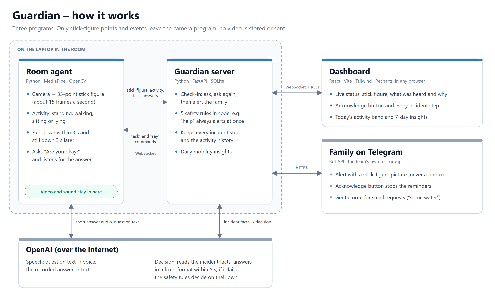

# Guardian

**Privacy-first fall detection for older people who live alone.** A camera in the corner of the
room sees a fall, Guardian asks the person "Are you okay?" out loud, listens to the answer, and
alerts the family on their phones only when it should. No video ever leaves the laptop.

Built in 48 hours for BUHack 2.0 (13–15 Nov 2026).

**Demo video:** on YouTube, linked from our BUHack 2.0 submission on MentorMates.

> Guardian is a prototype safety aid, **not a medical device**. During the hackathon its alerts went
> only to the team's own Telegram test group, never to emergency services.



## What it does

1. **Watches without filming.** The room agent turns every camera frame into a 33-point stick
   figure (Google MediaPipe Pose) about 15 times a second and labels what the person is doing:
   standing, walking, sitting, lying. Frames are processed in memory and dropped; only the stick
   figure and events travel on.
2. **Spots a fall.** Upright to on the floor within 3 s, and still down 3 s later, is a fall. Lying
   still on the floor for 60 s outside a safe zone is found too, so a slow slide to the floor is
   caught. Lying on the sofa is not a fall: the sofa is drawn as a safe zone on the camera image.
3. **Talks to the person first.** "Are you okay? Please say yes or no." Guardian listens, turns the
   answer into text, and an AI model chooses the next step from a short list of allowed actions.
   If the answer is unclear it asks again: "Can you hear me? Say yes if you are okay."
4. **Alerts the family only when it should.** No answer, a cry for help or an injury sends a
   Telegram alert with a stick-figure picture (never a photo), what was heard, why Guardian
   decided to alert, and an **Acknowledge** button. The alert repeats every 2 minutes until someone
   acknowledges it, on the phone or on the dashboard.
5. **Handles the small things gently.** If the person is fine, Guardian asks "Do you need
   anything?". A request like "some water, please" reaches the family as a calm, non-urgent message.
6. **Keeps the family informed.** A web dashboard shows the live status, the stick figure, every
   step of every incident with the reason for each decision, the day as a timeline, and a weekly
   mobility trend in plain sentences ("Active 45% less than the 7-day average so far today.",
   "Stood up from sitting 3 times today.").

## The five safety rules (code, not AI)

The AI helps Guardian understand answers, but it can only make an alert come **sooner**, never
later. These rules live in [`server/escalation.py`](server/escalation.py) and override the AI:

1. No answer after two questions → alert the family, whatever the AI says.
2. Help words ("help", "hurt", "pain", "can't get up", ...) → alert at once, before the AI is asked.
3. Still on the floor 90 s after the fall, even after saying "I'm okay" → alert.
4. The AI fails or takes longer than 5 s → counts as no answer.
5. The AI must choose an action allowed at that step; anything else counts as "alert".

Also in code: Guardian only says "I have messaged your family. Help is coming." once an alert has
really gone out (until then, "I am trying to reach your family."), and a failed alert is retried
after 15 s. If the server restarts during an incident, the incident comes back as an alert. If the
camera stops working for 2 minutes, the family gets a message, and another one when it is back.

## Results

Measured on one ordinary laptop (Intel Core Ultra 7, no graphics card) with its built-in camera,
mounted high in a corner of a real room.

> **In our fresh test clips, Guardian caught all 8 falls that started from standing, each about
> 3 seconds after landing, with 0 false alarms in 6 normal movements** (fast sit on a chair, lying
> on the sofa, bending, kneeling). Falls that started from kneeling (4) were not caught within
> seconds; the 60-second "still on the floor" rule finds those.

This is a small, self-recorded test: one person, safe falls onto a mat, one room. The settings were
frozen before the fresh clips were recorded and each set was scored once. The details, including
the clips we tuned on, are in [`docs/accuracy.md`](docs/accuracy.md).

| Moment | Measured |
| --- | --- |
| Landing → Guardian asks "Are you okay?" | 3.6–4.2 s (3 s of it is the deliberate "still down?" check) |
| Landing → alert on the family's phone when nobody answers | 30–39 s (two questions, then the alert) |
| Lying still on the floor → Guardian checks in | 60 s |
| AI decision (gpt-5.4-mini) | about 1 s (median 1.06 s) |
| Server crash → restarted and everything reconnected by itself | within 4 s |
| 30-minute non-stop run | no crash, 90 incidents handled, 0 invalid messages, memory flat |

## Privacy

- **No video is stored or sent.** Camera frames never leave the room agent. The server, the
  dashboard and the family only ever see stick-figure points, activity labels and events.
- **The family alert picture is drawn from the stick figure** on a plain background, never a photo.
- **Voice:** short spoken answers go to OpenAI to be turned into text, and the fixed questions are
  spoken with OpenAI's voice. Silence is never sent, and Guardian never listens while it is talking.
- **Consent:** the person agrees to Guardian and chooses which rooms are watched.
- Keys live in `.env`, which is never committed.

## How it is built

| Part | What it does | Built with |
| --- | --- | --- |
| [`room-agent/`](room-agent/) | Camera → pose → activity and falls; speaks and listens | Python 3.11, MediaPipe Pose Landmarker (full), OpenCV, sounddevice, OpenAI speech |
| [`server/`](server/) | Check-in flow, the five rules, AI decisions, family alerts, history | FastAPI, WebSockets, SQLite (SQLModel), OpenAI (strict JSON output), Telegram Bot API |
| [`dashboard/`](dashboard/) | Live status, incidents with reasons, timeline, insights, settings | React 19, Vite, Tailwind CSS, Recharts |
| [`contracts/`](contracts/) | JSON Schemas for every message; checked in both directions | jsonschema |
| [`config/`](config/) | Every threshold and timing, so tuning needs no code change | JSON |

How a fall is recognised from a camera mounted high: a fall towards or away from the camera
barely tilts the body in the picture, so Guardian measures how much of the torso still points
upwards compared with the last time the person stood (the "torso ratio"), plus the body's shape.
Why, and what the clips showed, is in [`docs/DECISIONS.md`](docs/DECISIONS.md) (D-007).

The AI (OpenAI `gpt-5.4-mini`, no extra reasoning, strict JSON schema) receives the question that
was asked, the transcript and the person's posture, and returns an assessment, an action from the
allowed list, an optional sentence to say and a reason. Every decision is stored with its reason
and shown on the dashboard as "AI: ..." or "Safety rule N: ...".

## Run it

Tested on Windows 11 with Python 3.11 and Node.js 24. `start.sh` is the Mac/Linux equivalent
(not tested by us).

1. **Install**
   ```
   git clone https://github.com/SomeRadGuy/guardian.git
   cd guardian
   py -3.11 -m venv .venv
   .venv\Scripts\python.exe -m pip install -r requirements.txt
   cd dashboard
   npm install
   cd ..
   ```
2. **Download the pose models** (about 15 MB) into `room-agent/models/`:
   ```
   curl.exe -L --create-dirs -o room-agent/models/pose_landmarker_full.task https://storage.googleapis.com/mediapipe-models/pose_landmarker/pose_landmarker_full/float16/latest/pose_landmarker_full.task
   curl.exe -L --create-dirs -o room-agent/models/pose_landmarker_lite.task https://storage.googleapis.com/mediapipe-models/pose_landmarker/pose_landmarker_lite/float16/latest/pose_landmarker_lite.task
   ```
3. **Settings:** copy `.env.example` to `.env`. For the real thing, fill in `OPENAI_API_KEY`,
   `TELEGRAM_BOT_TOKEN` and `TELEGRAM_CHAT_ID`. Without them Guardian still runs: a word-rule
   stand-in replaces the AI and family alerts go to the server log.
4. **Start.** To try it without a camera, microphone or keys:
   ```
   .\start.bat --mock --no-telegram
   ```
   A scripted stick figure moves about; start a practice fall with Settings → "Simulate a fall".
   Nobody answers in mock mode, so you see the whole escalation.
   With a camera and keys, run `.\start.bat` (real camera, voice, AI and Telegram); add `--demo`
   to make the dashboard follow each incident by itself.
   The dashboard opens at http://localhost:5173 (also reachable from a phone on the same network).
   `stop.bat` stops everything. `.venv\Scripts\python.exe scripts\preflight.py` checks the setup
   and prints a green or red list.

With a real camera, a local debug window shows the stick figure on the camera image (it never
leaves the laptop): `Z` then clicks then `S` draws a safe zone, `Space` answers "I'm okay", `C`
pretends the camera is unplugged, `Q` quits.

## Tests

- `.venv\Scripts\python.exe -m pytest`: 282 tests, including every safety rule.
- `.venv\Scripts\python.exe scripts\sim_scenarios.py`: both demo scenarios end to end on recorded
  falls.
- `npx vitest run` in `dashboard/`: 16 dashboard tests.

`sim_scenarios.py` needs the recorded clips, which stay on our laptop (they show a person), so it
only runs there. Other helpers are listed in [`scripts/README.md`](scripts/README.md).

## Known limits

- One camera, one room. Someone hidden behind furniture cannot be seen.
- A fall that starts from sitting or kneeling is found by the 60-second floor rule, not within
  seconds. Lying down on the floor quickly on purpose looks like a fall, so Guardian asks.
- The voice check-in understands English. "Help" said while Guardian is still asking is not heard
  (it listens after its question); the second question and rule 1 still alert about 15 s later.
- Loud noises are sometimes transcribed as random words (in our filmed takes: Turkish, Urdu and
  Chinese text for loud sounds in the room). The AI read each one as unclear, so Guardian asked again
  or alerted. And whatever is heard, someone still on the floor 90 s after a fall triggers an alert.
- The accuracy figures come from a small test with one person doing safe falls. The week of
  history on the Insights page is simulated and labelled as such.

## Repository

| Path | Contents |
| --- | --- |
| `room-agent/`, `server/`, `dashboard/` | the three programs (each has its own README) |
| `contracts/`, `config/` | message schemas; thresholds and timings |
| `scripts/` | start, preflight, demo reset, clip recording and scoring, scenario simulator, soak test |
| `tests/` | Python tests |
| `docs/` | build plan, progress log, decisions, accuracy, handoff packs |
